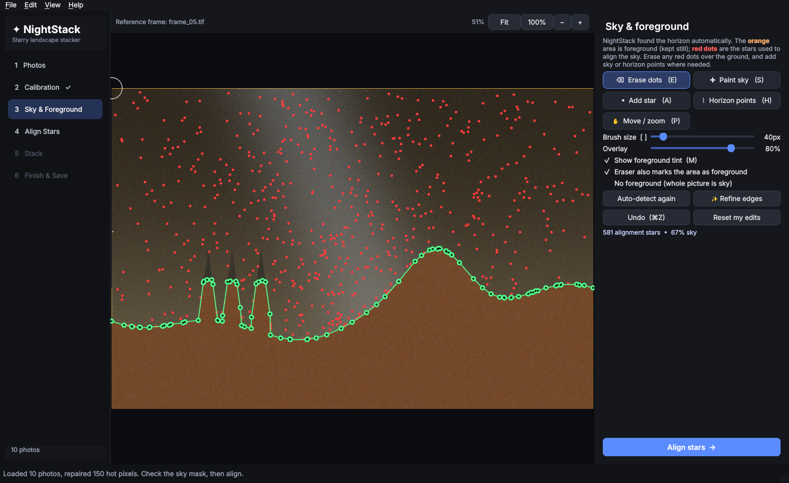

# ✦ NightStack

**Friendly starry-landscape stacking for Intel Macs.** Stack a series of night-sky exposures to cut
noise while keeping **both the stars and the foreground sharp**, in the spirit of Starry Landscape
Stacker, with Siril-style calibration and stacking under the hood.



## What it does

| Step | What happens |
|---|---|
| **1 Photos** | Drag in 10–30 tripod exposures: RAW (CR2/CR3/NEF/ARW/RAF/ORF/RW2/DNG…), TIFF, JPEG, PNG or FITS. |
| **2 Calibration** *(optional)* | Master **darks / flats / bias** (median-combined). **Hot & cold pixels are removed automatically** even without darks: stars drift between frames, hot pixels don't. |
| **3 Sky & Foreground** | The sky is **separated from the landscape automatically** (star motion + star density + brightness → horizon search → GrabCut edge refinement). Then refine it just like Starry Landscape Stacker: **erase red alignment dots over the ground**, **paint sky**, **add stars**, or **add/drag green horizon points**. Undo with ⌘Z. |
| **4 Align** | Every red-dot star is tracked (pyramidal optical flow, forward/backward-checked, sub-pixel centroids). The sky's rotation is fitted as a **homography**, which is exact for a fixed tripod and a rectilinear lens. An optional **wide-angle lens correction** adds a smooth local warp for corner distortion. The ground is never warped. |
| **5 Stack** | Sky from the aligned frames, foreground from the originals. Methods: **sigma-clipped mean** (removes planes & satellites), **median**, mean, winsorized, max. Blending: **Minimum Horizon Noise** or standard feathered edge. **Star-trail** (lighten) mode too. |
| **6 Finish & Save** | Brightness/black point/contrast/saturation, **light-pollution gradient removal**, sky colour neutralisation, extra sky/foreground smoothing, highlight protection. Save **16-bit TIFF**, JPEG, PNG, 32-bit TIFF or **FITS**, optionally **linear** data and separate sky / foreground / mask layers for Photoshop. |

### Techniques borrowed from the best
| From | Technique | In NightStack |
|---|---|---|
| **Siril** | Calibration on raw Bayer data *before* demosaicing | Automatic when lights + darks/flats/bias are all RAW |
| **Siril** | Sigma-rejected master darks/flats/bias | Masters use sigma clipping (5+ frames) |
| **Siril** | Rejection algorithms | Sigma, winsorized sigma, linear-fit, MAD, percentile clipping, plus median/mean/max |
| **Siril** | Frame normalisation (additive + scaling) | Matches each frame's sky level & spread to the reference |
| **Siril** | Frame weighting & selection by FWHM / roundness / background | Per-frame quality table; auto-skips blurry, bumped, cloudy or bright frames |
| **Siril** | Background extraction, asinh stretch | Gradient removal (4 complexity levels); colour-preserving asinh tone curve |
| **Starry Landscape Stacker** | Auto sky detection + editable alignment dots / horizon | Red dots, eraser, sky brush, green horizon points, undo |
| **Starry Landscape Stacker** | Dense local alignment for wide-angle lenses | Homography + smooth lens-distortion field |
| **Starry Landscape Stacker** | Minimum-horizon-noise stacking | Validity-tracked sky + all-frames fill near the horizon |
| **Sequator** | Freeze ground / separate foreground exposures (HDR blend) | Optional foreground photos, brightness-matched to the night frames |
| **Sequator** | Enhance star light, reduce light pollution | "Enhance stars" slider; gradient removal |
| **Sequator** | Time-lapse output, speed | Export all aligned frames; multi-core stacking |

### Minimum Horizon Noise, explained
After aligning, the sky just above the horizon is covered by ground in *some* frames (the ground
doesn't rotate with the stars), so fewer frames contribute there and that band ends up noisier. NightStack:
1. tracks, per pixel, which frames really saw sky (a warped sky mask with a small *horizon guard*), so **ground
   never bleeds into the sky** (no glow or dark halo along the skyline);
2. where only a fraction of frames saw sky, it **blends toward the all-frames stack**, weighted by how many frames
   are missing, so the horizon band is as clean as the rest of the sky;
3. keeps the edge **crisp on the ground side**, so trees and rocks don't get a halo.

Use *Stack → Show → Frames used per pixel* to see the band it fixes.

## Install

### Option A: build the app (recommended)
On your Intel Mac (macOS 11 or later), install **Python 3.12** from [python.org](https://www.python.org/downloads/macos/), then:
```bash
cd NightStack
./build_mac.sh
```
This creates `dist/NightStack.app` and `dist/NightStack.dmg`. The first time you open it, **right-click → Open**
(the app is ad-hoc signed, not notarized by Apple).

### Option B: let GitHub build it
Push this folder to a GitHub repository and run the **Build macOS (Intel)** workflow (Actions tab).
Download `NightStack.dmg` from the run's artifacts.

### Option C: run from source
Double-click `run_from_source.command`, or:
```bash
python3 -m venv .venv && .venv/bin/pip install -r requirements.txt
.venv/bin/python main.py
```

## Batch / command line
```bash
python -m nightstack ~/Pictures/MilkyWay/*.CR2 -o milkyway.tif --darks darks/*.CR2 --layers
python -m nightstack frames/*.NEF --trails -o trails.jpg
python -m nightstack night/*.ARW --foreground bluehour.ARW --sky linear --enhance-stars 0.4 -o final.tif
```

## Tips for great results
* Shoot 10–30 frames back-to-back with the same settings (e.g. 14 mm, f/2.8, 15–20 s, ISO 3200–6400).
* Use the **middle frame as reference** (default): star motion is spread evenly both ways.
* In step 3, zoom to the horizon (pinch / ⌘-scroll) and check the edge; drag green horizon points onto treetops,
  and erase any red dots sitting on lights, buildings or rocks.
* **Fast mode** (half resolution) is great for testing settings.
* Disk: frames are cached as half-precision on disk in `~/Library/Caches/NightStack` (about 150 MB per 24 MP
  frame, ×2). The cache is deleted when you quit.

## Keyboard shortcuts (step 3)
`E` erase dots · `S` paint sky · `A` add star · `H` horizon points · `P` move · `[` `]` brush size ·
`M` toggle tint · `Space`+drag pan · ⌘Z undo · ⌘0 fit · ⌘1 100%

## Scope vs. Siril
NightStack covers the **landscape-astrophotography** part of Siril: calibration, cosmetic correction,
registration, rejection stacking, background extraction, colour neutralisation, stretching and FITS I/O.
It doesn't do deep-sky/tracked-mount features: plate solving, photometric colour calibration, drizzle, comet
registration, deconvolution, star removal or scripting.

## Tests
```bash
python tests/test_pipeline.py   # end-to-end on a synthetic sky with known ground truth
python tests/gui_smoke.py       # drives the whole GUI headlessly, saves screenshots
```
The synthetic test checks: sky-mask accuracy (IoU ≥ 0.97), alignment error vs. the true sky rotation (< 0.5 px; typically
0.05–0.15 px), noise reduction (≈ √N), star sharpness and satellite rejection.

## Project layout
```
nightstack/
  imageio.py      RAW/TIFF/JPEG/FITS I/O, sRGB↔linear, on-disk frame cache
  calibration.py  master darks/flats/bias, hot-pixel voting
  skymask.py      automatic sky detection + editable mask model
  stars.py        star detection & sub-pixel centroids
  align.py        star tracking, homography + lens-distortion field, warping
  stack.py        mean/median/sigma/winsor/max + Minimum Horizon Noise blending
  postprocess.py  gradient removal, neutralisation, denoise, tone curve
  pipeline.py     Project object used by GUI and CLI
  gui/            PySide6 interface
packaging/        PyInstaller spec (x86_64 .app)
```
